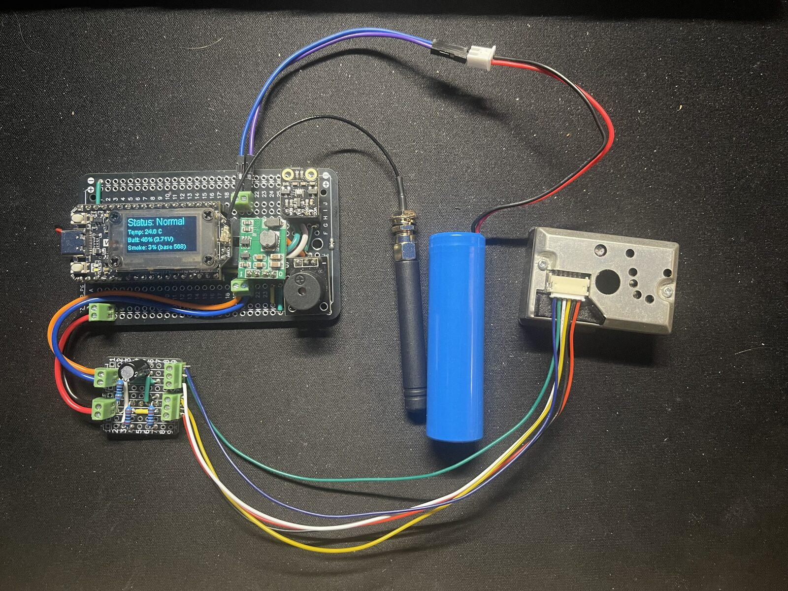
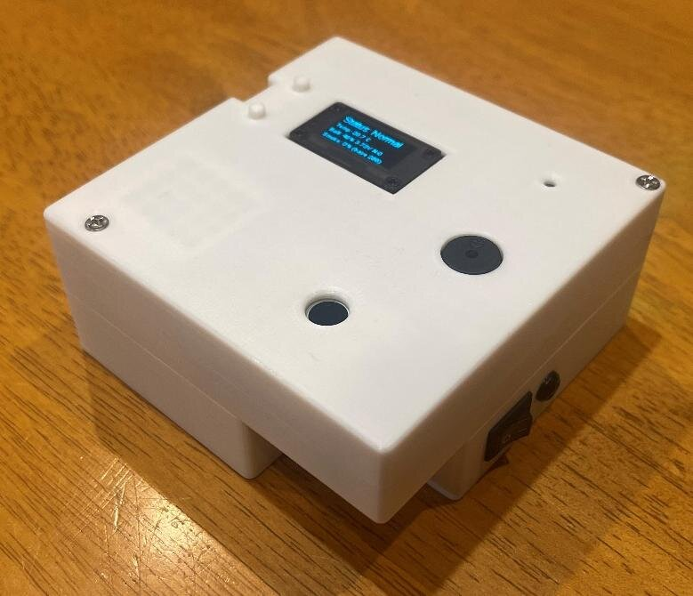
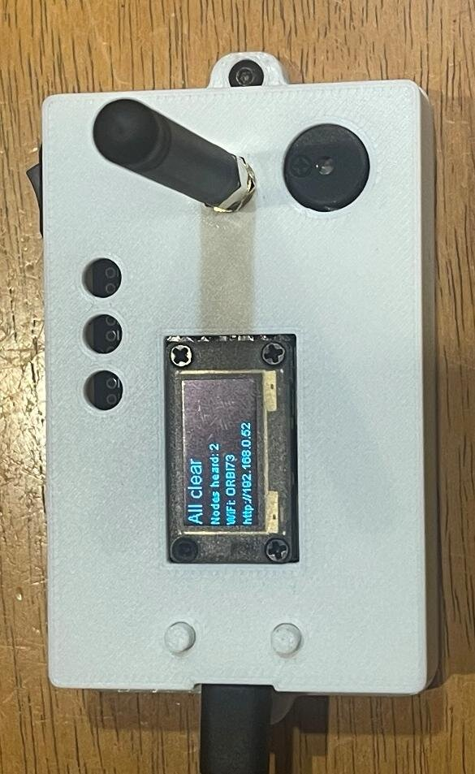
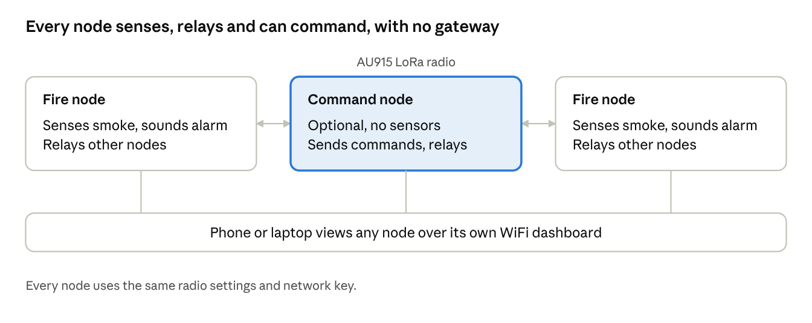
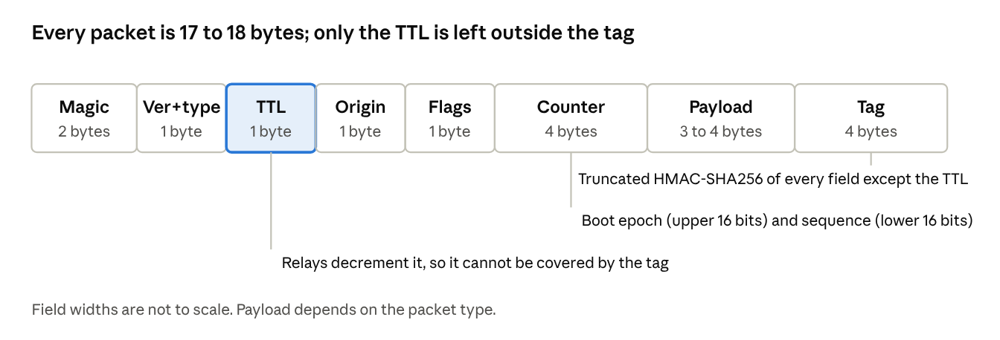
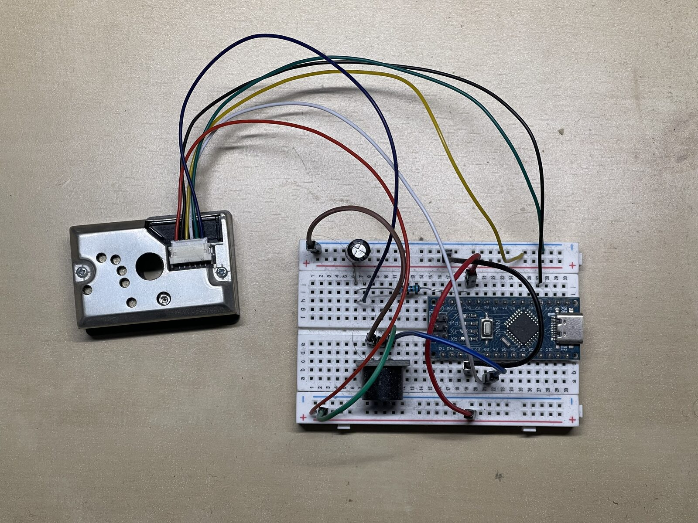
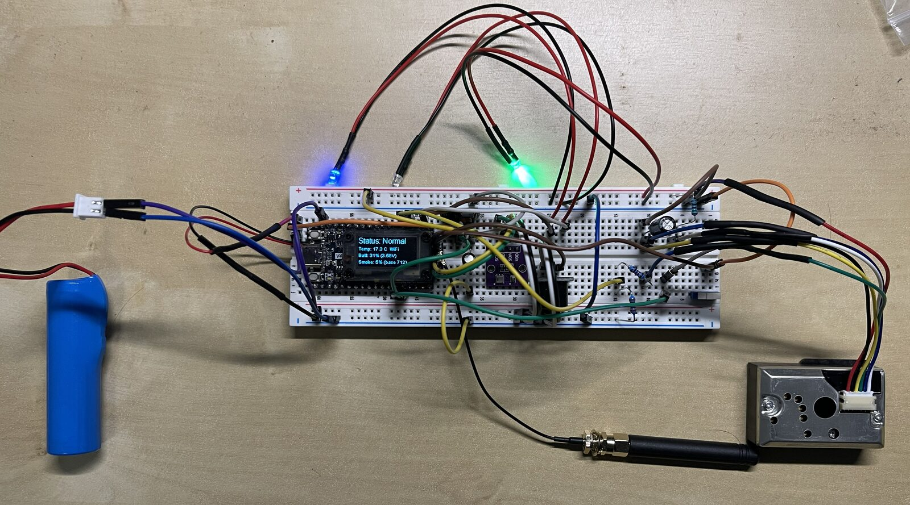

# LoRa Fire Alarm Mesh

[](https://github.com/MitchellPescud/LoRa-Fire-Alarm-Mesh-System/actions/workflows/tests.yml)

A **gateway-free wireless fire-detection network** built on Heltec WiFi LoRa 32 V4.3 boards (ESP32-S3 + SX1262, 915 MHz AU915). Every node senses smoke, sounds a local alarm, and relays alerts for every other node, so a fire detected in one building is heard in all of them with no router, gateway or internet connection. Designed for spread-out sites such as farms, where buildings can be hundreds of metres apart.

Two-semester university engineering project (Computer Technology Project, CMPE3002/CMPE3003, Curtin University) - Mitchell Pescud.

> **Status:** working hardware prototypes (hand-wired, no PCB) demonstrated in a final oral presentation. Firmware V6 is the demo version. Real-world range and long-duration battery testing are limited - see [Limitations](#limitations).

<p align="center">
  
  
  
</p>

## What it does

- **Managed-flooding mesh** (Meshtastic-style): every node transmits, receives and relays; TTL, duplicate suppression, RSSI-based relay back-off and listen-before-talk to cut collisions.
- **Authenticated packets:** every packet carries a 4-byte truncated HMAC-SHA256 tag over a pre-shared key, plus a custom sync word and network magic. Replay protection uses a (boot epoch, sequence) counter - the epoch is stored in flash once per boot, so there are no per-packet flash writes.
- **Alarm episodes:** `FIRE` is a *state*, re-announced every ~5 s with an episode ID. `SILENCE` (mute buzzers) and `CLEAR` (end the episode) are separate flooded commands; a stale `FIRE` for a cleared episode is dropped everywhere.
- **Fail-safe by design:** a node that goes silent is shown as *unknown*, never *safe*.
- **Node-to-node commands (V5+):** any node can test-fire, recalibrate, reboot or query any other node, with ACKs that travel back across relays.
- **Smoke + heat sensing:** Sharp GP2Y1010AU0F optical dust sensor with a self-calibrating baseline and hysteresis, confirmed against BMP280 temperature trend.
- **Web dashboard** served from each node's WiFi access point (per-node status cards, silence/clear, remote commands), plus an optional **command node** (antenna + buzzer + dashboard) as an easier interface - it is not a gateway and the mesh does not need it.
- **Power-aware (V6):** mains with 18650 battery backup, filtered battery readout, and a low-power mode (CPU down-clocking, OLED sleep).

## Architecture



```
  Fire node 1 ----\                 /---- Fire node 3
  (smoke+heat,     \               /      (relays too)
   buzzer, OLED)    >-- LoRa 915 --<
  Fire node 2 ----/    managed      \---- Command node (optional)
                       flooding           WiFi AP + dashboard

  Packet handling order:  magic -> HMAC -> own-echo -> replay window
                          -> cleared-episode check -> act -> relay
```

Packets are 17-18 bytes: network magic, version/type, TTL, origin, flags, 32-bit counter, payload, 4-byte tag (TTL is excluded from the tag so relays can decrement it). Types: `FIRE`, `HEARTBEAT`, `SILENCE`, `CLEAR`, `CMD`, `ACK`. Full detail in [docs/design.md](docs/design.md).



## Hardware

| Part | Role |
|---|---|
| Heltec WiFi LoRa 32 V4.3 | ESP32-S3, SX1262, KCT8103L PA/LNA front-end (28 dBm) |
| Sharp GP2Y1010AU0F | Optical smoke / dust sensor |
| BMP280 | Temperature (secondary fire confirmation) |
| DDEN12MB boost converter + 18650 cell | 5 V rail for the dust sensor, battery backup |
| Schottky diode-OR | Seamless USB / battery 5 V rail |
| Buzzer, LEDs, WiFi + power switches | Local alarm and UI |

The 3D-printed enclosure (designed in Fusion) is in [hardware/case](hardware/case) with STL files and dimensioned drawings. Pin assignments, the wiring diagram and photos are in [docs/hardware.md](docs/hardware.md).

## How it evolved
| Semester 1 (May 2026) | Breadboard V1 (Aug 2026) | Final board (Sep 2026) |
|---|---|---|
|  |  |  |
| Arduino Nano reading the Sharp dust sensor: basic smoke sensing only | First LoRa node: Heltec V4.3, BMP280, WiFi dashboard, LEDs | Hand-wired fire node board in its final layout |

## Repository layout

```
firmware/
  fire_node/            V6 fire node (Arduino sketch) + host tests in tests/
  command_node/         V2 command node
  test_builds/          instrumented firmware used for the mesh and range tests
tools/
  mesh_test/            logger, analyser and raw logs for the relay tests
  range_test/           logger and analyser for the range walk tests
docs/                   design, requirements, test results, power, hardware notes, range-test charts/data, images, dashboard previews
hardware/case/          fire node (STL parts + drawings) and command node (STL) enclosures
```

## Build and flash

1. Install the Heltec ESP32 board package (`https://resource.heltec.cn/download/package_heltec_esp32_index.json`) and the SSD1306 display library.
2. Arduino IDE settings: USB CDC On Boot **Enabled**, Flash **16MB**, PSRAM **OPI**, CPU 240 MHz, LoRa FEM **USE_KCT8103L_PA**.
3. In each sketch folder, copy `secrets.example.h` to `secrets.h` and set your own 128-bit key (**identical on every node**).
4. In `config.h`, set a unique `NODE_ADDR` per fire node and **change the default WiFi AP password**.
5. Open `firmware/fire_node/fire_node.ino` (or `command_node.ino`) and upload.

## Tests

Host tests run on a PC with `g++` - no hardware needed (see [firmware/fire_node/tests](firmware/fire_node/tests)):

```
cd firmware/fire_node/tests
g++ -std=c++11 -Wall -I.. test_proto.cpp ../mesh_proto.cpp -o test_proto && ./test_proto
g++ -std=c++14 -Wall -Wno-unused-variable -Wno-unused-function -Istubs sim_mesh.cpp -o sim_mesh && ./sim_mesh
g++ -std=c++11 -Wall -I.. test_battery.cpp -o test_battery && ./test_battery
```

- `test_proto` - encode/decode of every packet type, tamper on every byte, wrong key, replay window, wire format cross-checked against Python's `hmac`.
- `sim_mesh` - the **real** mesh and alarm code running on 3-4 virtual nodes over a simulated radio (range, airtime, collisions, hidden nodes, 30% loss): 64 checks.
- `test_battery` - the V6 battery filter against a simulated noisy ADC with TX current sag.

## Results (bench and field)

| Test | Result |
|---|---|
| Alarm propagation, direct (5 cycles) | FIRE / SILENCE / CLEAR reached both other nodes every cycle; FIRE latency 0.76 s |
| Alarm propagation, forced relay (1 - 100 - 2) | Reached the far node via the relay in 5/5 cycles (CLEAR 4/5); FIRE latency about 2.1 s - each hop costs roughly 0.7-0.9 s |
| Single-hop range (SF9, urban walks) | 100% at ~37 m; at ~160 m anywhere from 48% to 95% depending on obstruction; 46-66% at 236-273 m. A clear 699 m line-of-sight path delivered 98-100% when exactly on the line |
| SF9 vs SF11 | SF11 gained only ~2.3 dB for ~3.5x the airtime, so the mesh stays at SF9 |
| Current draw (V6, battery, low-power mode) | 0.07 A WiFi off / 0.15 A WiFi on (quick measurement); about 54 h / 25 h on the 3800 mAh cell if the draw were constant - theoretical, no discharge test |

All range tests used a 10 dBm chip setting and a small spring antenna lying inside the closed case near the ground, so the range figures are a **conservative lower bound**, not the system's maximum. Method, tables and caveats: [docs/test-results.md](docs/test-results.md); charts and tables: [docs/range-test](docs/range-test); each requirement against its result: [docs/requirements.md](docs/requirements.md).

## Limitations

Stated up front, because they matter:

- **Mesh range was not tested in the field** - relaying was verified on a bench with software-forced topology, and single-hop range on one hardware pair in one session per spreading factor with no repeats.
- Bench delivery was 66-86% per link, mostly collisions from three nodes on one desk, not range loss.
- No full battery-discharge test yet; the 3800 mAh cell figure is nominal. Battery/mains switchover only checks the power source at boot.
- **Not a certified smoke alarm.** It uses a hobby-grade optical dust sensor; the self-calibrating baseline detected real match and incense smoke, but no detection time, false-alarm rate or comparison with a certified detector was measured.
- Transmit power compliance (30 dBm EIRP) is not verified: antenna and front-end gain were not measured.
- Prototypes are hand-wired; no PCB. The dashboard has no login beyond the WiFi AP password, and the 4-byte tag with a shared key is adequate for this project but not strong against a determined attacker.
- Firmware compiles and runs on the real boards, but PC tests cover the protocol, mesh logic and battery filter only - not RF behaviour.

## Roadmap

Repeat the range walks at identical points and add a coast run; step TX power and test antenna height to measure real margin; a multi-hop field trial on a real farm layout; normal-mode and alarm current plus a full discharge test; SX1262 RxDutyCycle with long-preamble alerts; runtime mains/battery switchover; per-node keys or key rotation, a longer tag and a dashboard login; move the alarm LED to a free pin (GPIO38-42); a certified sensing module; and a PCB.

## Development notes

Firmware, host tests and analysis scripts were developed with AI coding assistance (Claude); system design, hardware, bench debugging and all physical testing were done by the author. The git history was **reconstructed from the author's saved version snapshots (V1-V6)** using their original file modification dates, so each commit is a snapshot rather than a live work log. Tags `v1`-`v6` mark the versions; `board-bringup` (V2) and `feature/range-test` / `feature/mesh-test` are real side lines of work. See [docs/timeline.md](docs/timeline.md).

## License

MIT - see [LICENSE](LICENSE).
