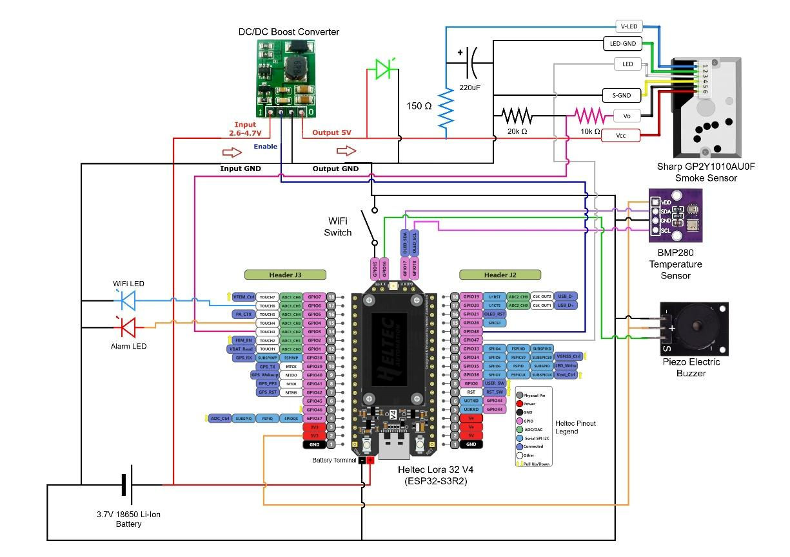
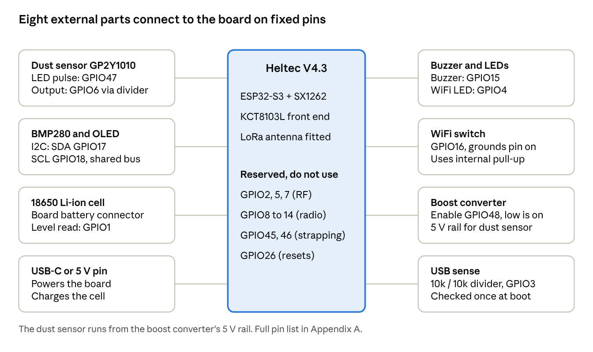
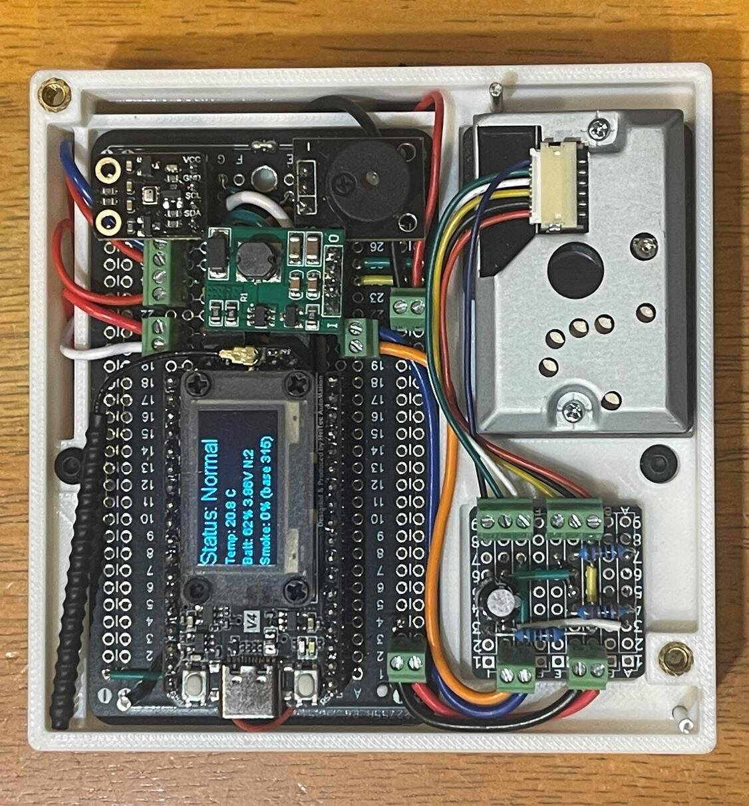
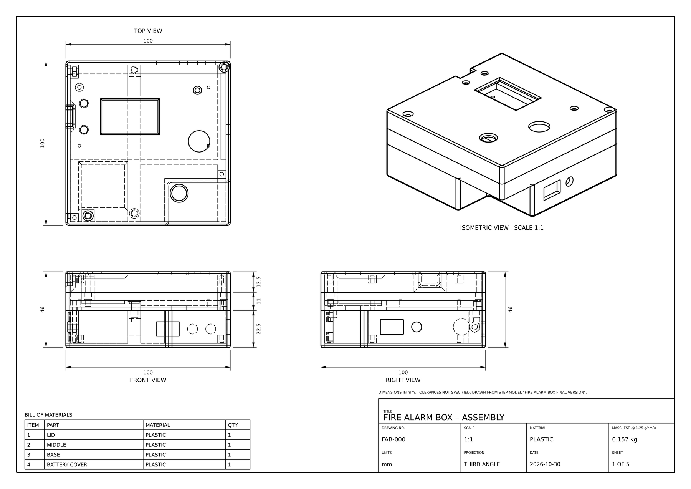

# Hardware notes

## Pin map (V3 boards - current standard)
| GPIO | Function |
|---|---|
| 17 / 18 | I2C SDA / SCL (OLED 0x3C, BMP280 0x76/0x77) |
| 3 | 5 V rail sense (resistor divider, used to detect USB presence) |
| 6 | Dust sensor Vo (ADC, divider + 0.1 uF filter) |
| 47 | Dust sensor LED pulse |
| 48 | Boost converter enable (LOW = on) |
| 15 | Buzzer |
| 16 | WiFi switch (active-low, INPUT_PULLUP) |
| 4 | WiFi LED (HIGH = on) |
| 5 | Alarm LED (HIGH = on) |
| 36 / 37 | Vext control / ADC control |
| 1 | Battery voltage read (board-reserved) |

Board-reserved (do not reuse): GPIO1 (VBAT), 2 (FEM_EN), 7 (VFEM_Control), 8-14 (radio SPI/IRQ), 33-37 (flash/PSRAM). Avoid strapping pins 45/46.

**Lessons learned:** GPIO5 is the KCT8103L `PA_CTX` pin on this board - using it as an output on the earlier breadboard unit burnt the driver out; the alarm LED is therefore disabled in the shipped sketches (`PIN_FIRE_LED = -1`) until it is moved to a free pin such as GPIO38-42. GPIO26 caused resets when used for the WiFi switch (cause not diagnosed). Always cross-check strapping, RF front-end and flash/PSRAM tables before assigning a pin.

## Power architecture
- 5 V rail: USB and the boost converter (from the 18650) combined by a Schottky diode in parallel with the existing USB diode (symmetric diode-OR).
- USB presence is detected on GPIO3 through a 10k/10k divider; GPIO48 enables the boost converter. USB-sense has debounce hysteresis to stop converter chatter.
- A measured ~0.1 mA leakage through the converter EN pin was judged acceptable against the 18650 capacity.
- Enclosure: 3D-printed, designed in Fusion (RF loss through common printed plastics is low; metal is the concern). STL files in `hardware/case/fire_node` (with the dimensioned drawings, `Fire_Alarm_Box_Drawings.pdf`) and `hardware/case/command_node`.

## Diagrams and photos

